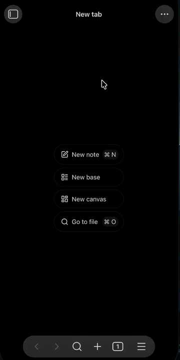

# Navbar Composer

Customise Obsidian's mobile navigation bar: add buttons for any command, hide the built-in ones and change their order. Works on phones and on tablets, where Obsidian normally hides the bar. Each device has its own layout.

## Setup

1. Install **Navbar Composer** from Community plugins and enable it.
2. Open **Settings → Navbar Composer** and choose the device.
3. Tap **Add button**, then choose a command and an icon.
4. Use ↑/↓ to reorder and the toggles to show or hide buttons. Changes apply immediately.
5. Turn all buttons off to hide the bar completely.
6. Turn on **Pin first button** or **Pin last button** to keep that button in place while the rest of the bar scrolls.

## Notes

- The device type is detected when Obsidian starts. Rotation, Split View and Stage Manager don't switch layouts until a restart.
- The plugin uses undocumented parts of Obsidian, so an Obsidian update may break it until the plugin is updated.

## License

MIT